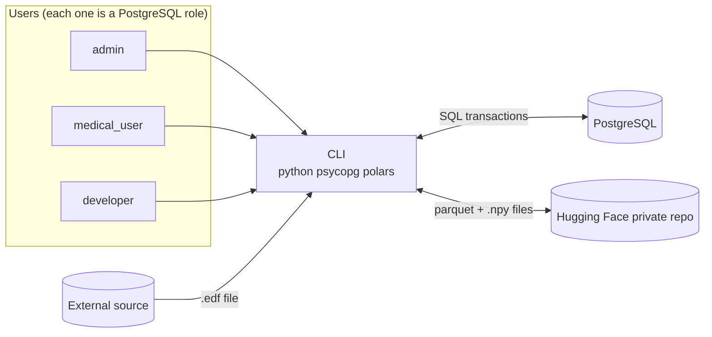
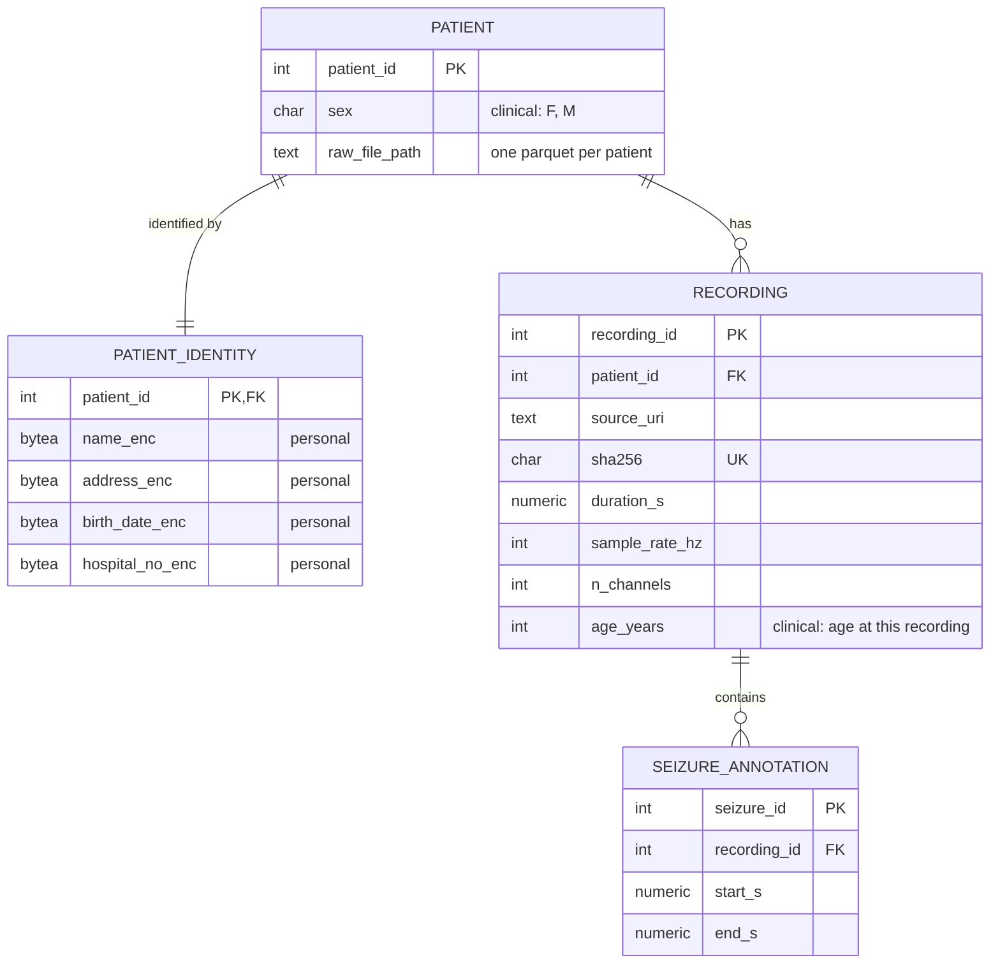

# Requirements: EEG seizure-detection DB (Group D)
`[ ]` to do · `[x]` done · **Rubric** = where it is graded  
Seizures = abnormal signal patern that used as labels for machine learning.

## Project vision
A database system that facilitates training-data sharing in medical machine learning (electroencephalogram signals in our case). It requires minimal infrastructure and is easy to use for developers (quick import for cloud training). It also respects the inherent privacy needed for medical data.
The database give access to proccessed data (.npy files) ready for training and the raw signals inside parquet files.

## Open decisions
- [ ] Does the instructor accept a CLI as the interface?
- [ ] improve ERD.

## Architecture
Every user goes through the CLI; the CLI never decides permissions, PostgreSQL does.



## ERD (draft)
All `*_enc` columns are encrypted (personal data only).



## Roles & privileges: Rubric 3.3 Security (5)
Each user category is a PostgreSQL role. Privileges are given with GRANT / REVOKE (least privilege).

Two kinds of patient metadata:
- **Personal** (identifies the person): name, address, date of birth, hospital number → encrypted, never accessible to developers
- **Clinical** (needed for ML): sex, age at each recording → not encrypted, accessible to all three roles

| Action | admin | medical_user | developer |
|---|:-:|:-:|:-:|
| Manage users (create, remove, change role) | ✓ | | |
| Create / edit patient metadata | ✓ | ✓ | |
| Read personal metadata | ✓ | ✓ | |
| Read clinical metadata | ✓ | ✓ | ✓ |
| Add / remove raw data | ✓ | ✓ | |
| Add / remove processed data (.npy, on Hugging Face) | ✓ | | ✓ |
| Download raw + processed signals | ✓ | ✓ | ✓ |
| Read seizure labels | ✓ | ✓ | ✓ |
| Run queries / transactions | ✓ | ✓ | ✓ |

## CLI (Python): Rubric Step 4 (15)

### Login & user management
- [ ] Each user logs in with their own PostgreSQL credentials; their role decides what they can do
- [ ] Only admin can create and remove users or change their role (no self sign-up)
- [ ] Passwords and decryption keys are never hard-coded or stored in the DB or repo
- [ ] Wrong password or missing permission → clear message, no stack trace

### Create patient
- [ ] admin, medical_user
- [ ] Patient gets a pseudonymous ID; only personal metadata is encrypted;

### Add / remove
- [ ] Add raw data from a .edf file: admin, medical_user
  - recording metadata (incl. patient's age at this recording) + file hash stored in the DB
  - seizure annotations read from the file and stored in the DB
  - signal added to the patient's raw parquet file; temporary .edf deleted
- [ ] Remove raw data: admin, medical_user; its seizures are removed with it, and its signal is removed from the patient's parquet file
- [ ] Add / remove processed .npy files: admin, developer; Hugging Face only, no change in the DB
- [ ] The same .edf can't be added twice
- [ ] Two adds / removes for the same patient can't run at the same time (they share one file)
- [ ] Each add is all or nothing (one transaction, Ch. 10)

### Run queries as transactions (Ch. 10)
- [ ] Run a query inside a transaction; an error rolls it back
- [ ] Run several statements (or a script) as one transaction, all or nothing
- [ ] Control a transaction by hand: begin, commit, rollback, savepoint
- [ ] Choose the isolation level and read-only mode
- [ ] Permissions come from the role: a forbidden query fails in PostgreSQL, not in the CLI
- [ ] Results shown as a table and can be saved to a file

### Download with private data
- [ ] admin, medical_user
- [ ] Personal fields decrypted
- [ ] Output stays local, never published to Hugging Face

### Download without private data
- [ ] developer: signals + seizure labels + clinical metadata, no personal metadata
- [ ] Consistent snapshot (one read-only transaction)
- [ ] Output stays local

### Convert the .edf files into a parquet file
- [ ] Part of adding raw data (see above), float16
- [ ] One parquet file per patient, holding all their recordings (each row tagged with its recording ID)
- [ ] Parquet holds signal values + pseudonymous patient ID + recording ID only, no patient metadata
- [ ] Signal values go into the file only, never into PostgreSQL
- [ ] DB records each recording's .edf hash and the patient's file path

## Hugging Face integration
Hugging Face hosts the raw data along with the processed data (one repo or two: see Open decisions).

The file structure of the Hugging Face repo is:
```
eeg-windows/
├── raw_signals/          # .edf converted to parquet, unchanged (medical_user)
|     ├── patient_1.parquet
|     ├── patient_2.parquet
|     ...
|     └── patient_n.parquet
├── Processed_signals/    # ready-to-run .npy windows, float16 (developer), not in the DB
|     ├── patient_1.npy
|     ├── patient_2.npy
|     ...
|     └── patient_n.npy
├── Metadata/             # seizure labels, pseudonymous IDs only
└── README.md             # dataset card: shapes, preprocessing version, etc.
```
- [ ] Private dataset repo; access token never in code
- [ ] Publishing uploads only the files that changed
- [ ] README.md lists shapes, sample rate, number of patients, preprocessing version

## PostgreSQL server: Rubric Steps 2–3 (25 + 20 + 5)
The PostgreSQL server is where the queries are run. It holds metadata only and decides truth, constraints and permissions.

### Tables (see ERD)
- [ ] `patient`: pseudonymous ID, sex, path of their raw parquet file
- [ ] `patient_identity`: 1:1 with patient; name, address, date of birth, hospital number (personal)
- [ ] `recording`: source, hash, duration, sample rate, channels, age at this recording
- [ ] `seizure_annotation`

### Constraints
- [ ] PK, FK with `ON DELETE` / `ON UPDATE`, NOT NULL, UNIQUE, CHECK, DEFAULT
- [ ] Seizure start < end; seizure end ≤ recording duration
- [ ] `sex IN ('F','M','U')`; `age_years BETWEEN 0 AND 120` (CHECK)
- [ ] At least 3 testable business rules, each enforced by a constraint

### Security (Ch. 16)
- [ ] Roles: `admin`, `medical_user`, `developer` (see matrix above)
- [ ] Personal data encrypted
- [ ] Developer has no privilege at all on `patient_identity`

### SQL
- [ ] Scripts in execution order: CREATE → INSERT (sample data) → UPDATE → DELETE
- [ ] Advanced queries (joins, GROUP BY, subqueries, window functions), each answering a business question, with an output screenshot
- [ ] Labeling logic (window → seizure / no seizure) as a SQL view

## Report & evidence: Rubric Step 5 (20) + oral
- [ ] One-page executive summary
- [ ] ERD, relational schema, data dictionary
- [ ] Appendices A–F
- [ ] Evidence log: one dated entry per week, every member
- [ ] AI use declaration
